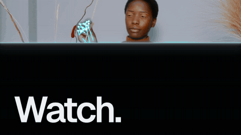
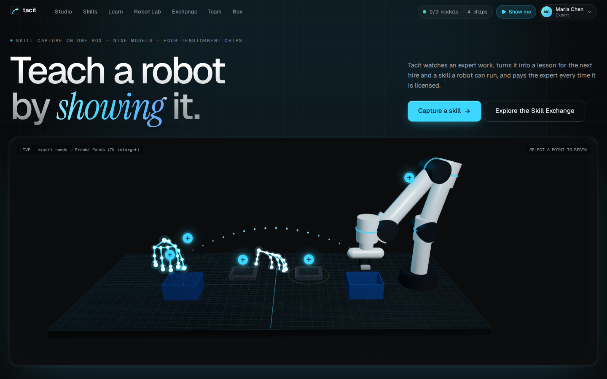
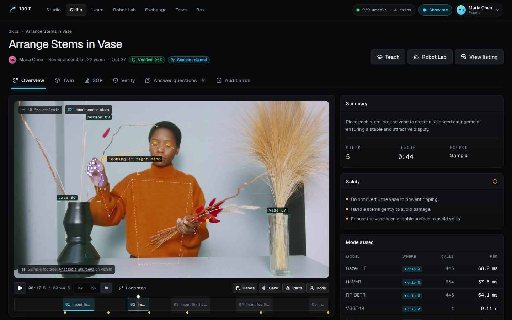
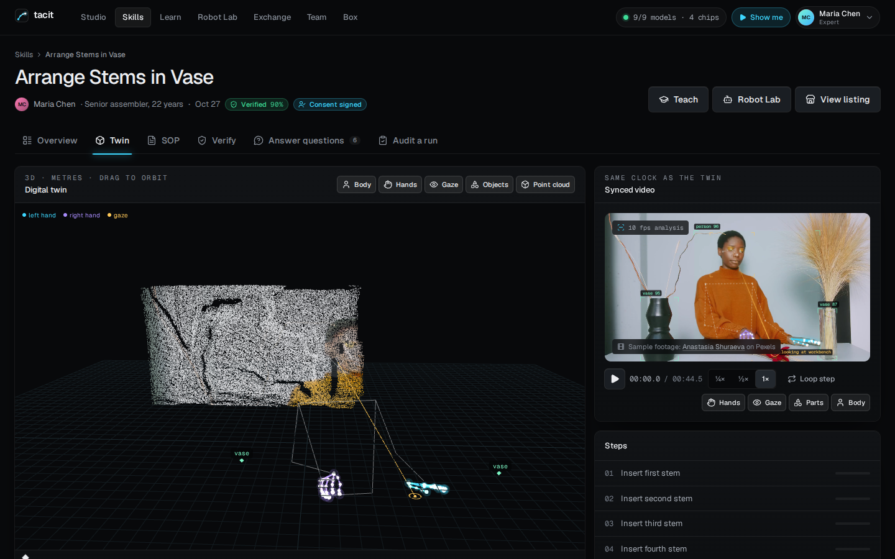
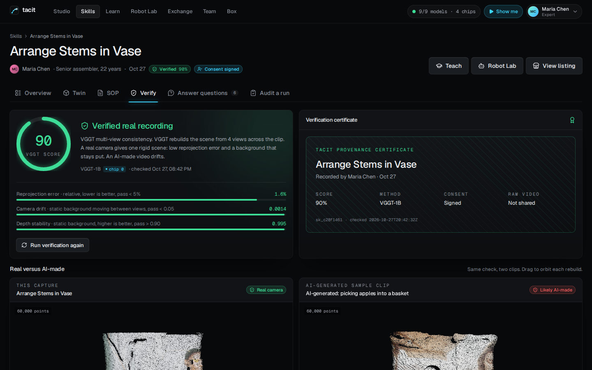
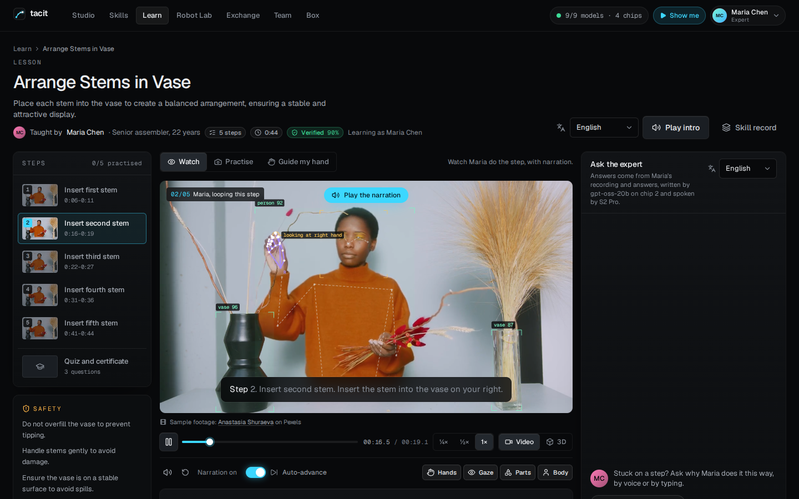
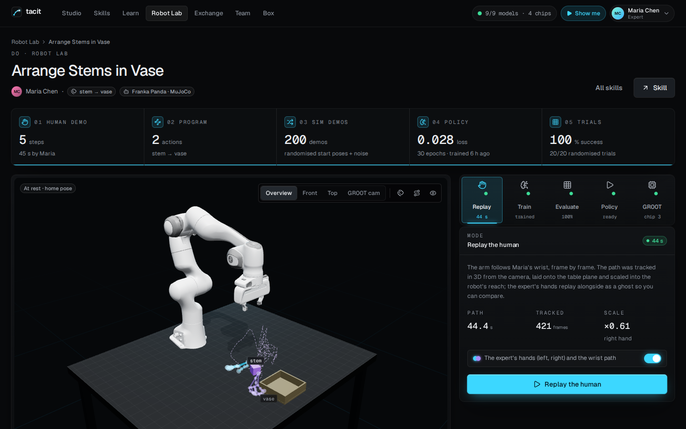
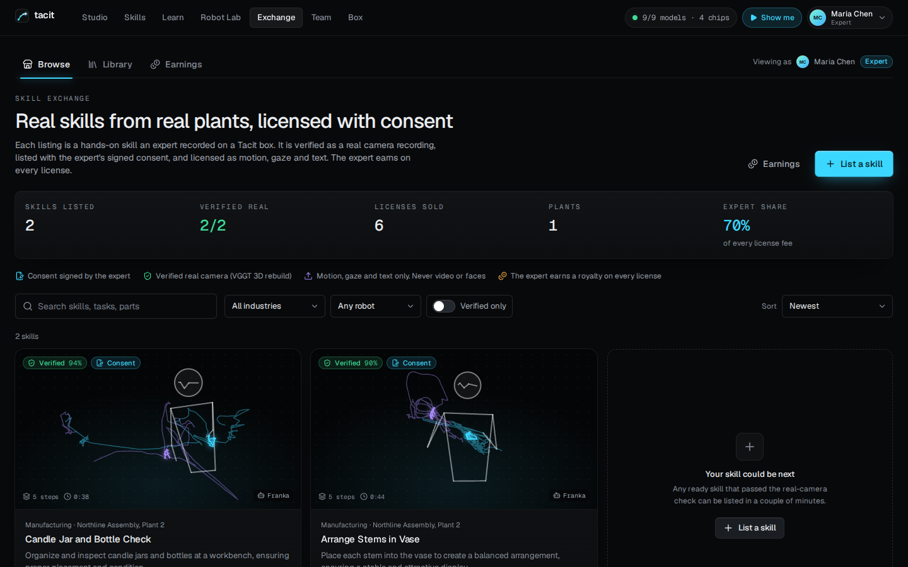
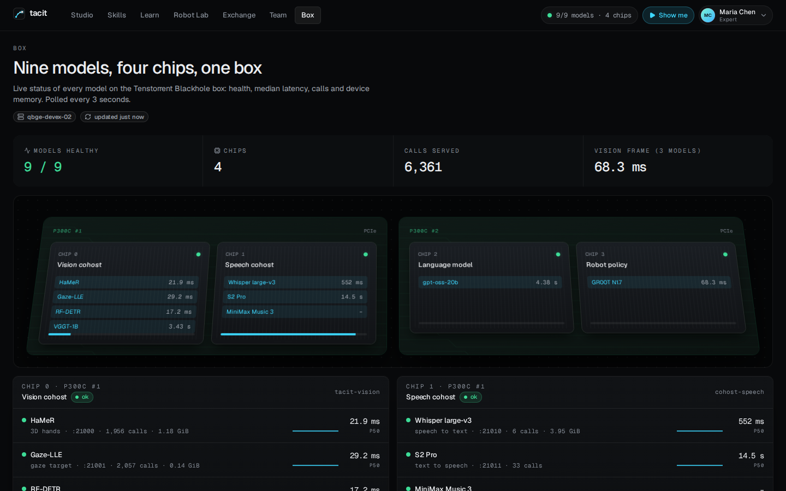

# Tacit

**Teach a robot by showing it.** Tacit watches an expert do a hands-on task, turns it into a lesson for
the next hire and a skill a robot can run, and pays the expert when the skill is licensed. Nine AI models
do it on one Tenstorrent Blackhole box (four chips) inside the plant; the video never leaves.

**Showreel (74 s, first cut):** [1080p download](https://github.com/jashansinghTT/tacit/releases/download/v1.0.0/tacit-showreel-1080p.mp4)
· [720p in the repo](docs/media/tacit-showreel-720p.mp4). The music was generated on the box (MiniMax Music 3).

## Screenshots

| | |
|---|---|
|  |  |
|  |  |
|  |  |
|  |  |

## Docs

- [Overview](docs/OVERVIEW.md): what it does, the models on each chip, how to run and develop it
- [Demo script](docs/DEMO.md) (6 minutes) · [Why it is hard to copy](docs/MOAT.md)
- [Spec](docs/SPEC.md) · [API](docs/API.md) · [Status and test evidence](STATUS.md)

Quick start on the box: `deploy/stack.sh up`, then open http://127.0.0.1:8710.

Personas are fictional; sample videos are Pexels and Pixabay stock footage, credited in the app. Some
models are non-commercial (HaMeR/MANO, VGGT): see [Licences and limits](docs/OVERVIEW.md#licences-and-limits).
